

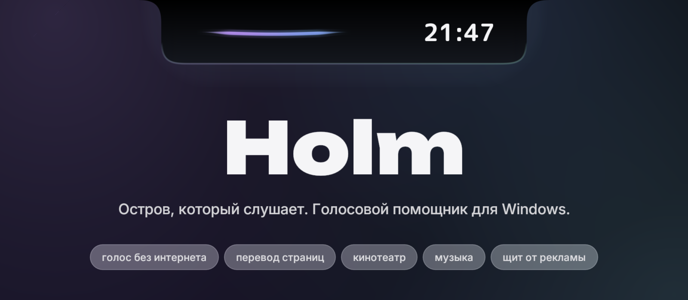

# Holm

Голосовой помощник для Windows. Живёт наверху экрана, понимает живую речь, 
переводит страницы прямо поверх них, гасит свет для кино и прячет рекламу. 
**Всё — на вашем компьютере. Бесплатно. Без аккаунтов.**

**[⬇ Скачать для Windows](../../releases/latest)** &nbsp;·&nbsp; [Что нового](CHANGELOG.md) &nbsp;·&nbsp; [Сообщить о проблеме](../../issues)

`Windows 10 / 11` &nbsp; `русский язык` &nbsp; `бесплатно` &nbsp; `без подписок и платных нейросетей`

---

## ✦ Остров

Наверху экрана — чёрная капсула, как Dynamic Island у iPhone. Она живёт:

- **в покое** — часы и волна, которая танцует под настоящий звук;
- **при наведении** — дата, нагрузка процессора и памяти;
- **с музыкой** — карточка трека с обложкой, перемоткой и текстом песни;
- **когда вы говорите** — лицо, которое слушает, думает, улыбается и хмурится.

Свет острова — цветами того, что играет. Меню и карточки — из жидкого стекла: перелив, блики, свет от курсора. Всё движется на пружинах, как в iOS.

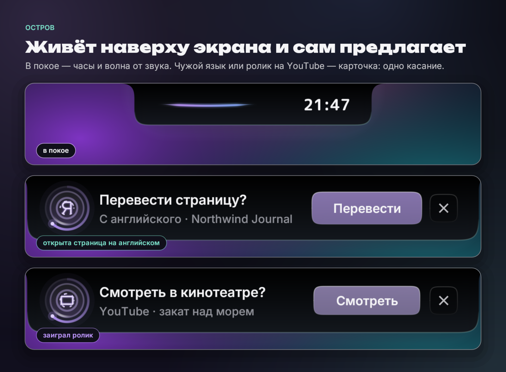

## 🎙 Голос — как с человеком

Скажите **«Холм»** — и что нужно, своими словами. Holm понимает живую речь: длинные фразы, оговорки, несколько просьб сразу, «нет» и «верни как было». После ответа можно продолжать без имени.

> «Холм, поставь таймер на десять минут и сделай погромче»
> «напомни через час позвонить маме»
> «сколько будет 15% от 3200?» · «5 миль в километрах» · «сколько дней до Нового года?»
> «что такое чёрная дыра?» · «какая погода завтра в Казани?»
> «запомни, что машина в сервисе» · «вставь объявление» · «скопируй ссылку»
> «подбрось монетку» · «выбери: пицца или суши»

**Свой мозг, без интернета.** Речь распознаётся на компьютере: слова появляются на острове сразу точными, с запятыми, а рядом — чип: что Holm сейчас сделает. Тяжёлое распознавание включается, только когда в микрофоне голос.

**Слух на выбор.** «Точный» — быстрый и точный, «Холм» (бета) — лучше знает слова Holm, «Лёгкий» — бережёт силы. Меню → «Звук» → «Голос»: живая сцена показывает, кто слушает, что услышал и за сколько.

**Мой голос.** Прочитайте вслух восемь фраз — минута, — и Holm запомнит, как именно у вас звучат его имя и просьбы.

**Понимание (бета).** «Засеки семь минут на пельмени», «этот трек так себе, давай другой» — когда правил мало, просьбу читает языковая модель прямо на вашем компьютере. Ставится одной кнопкой (2,6 ГБ), берёт около 3 ГБ памяти видеокарты и уходит из неё, как только началась игра. Ничего опасного сделать не может.

<table>
<tr>
<td>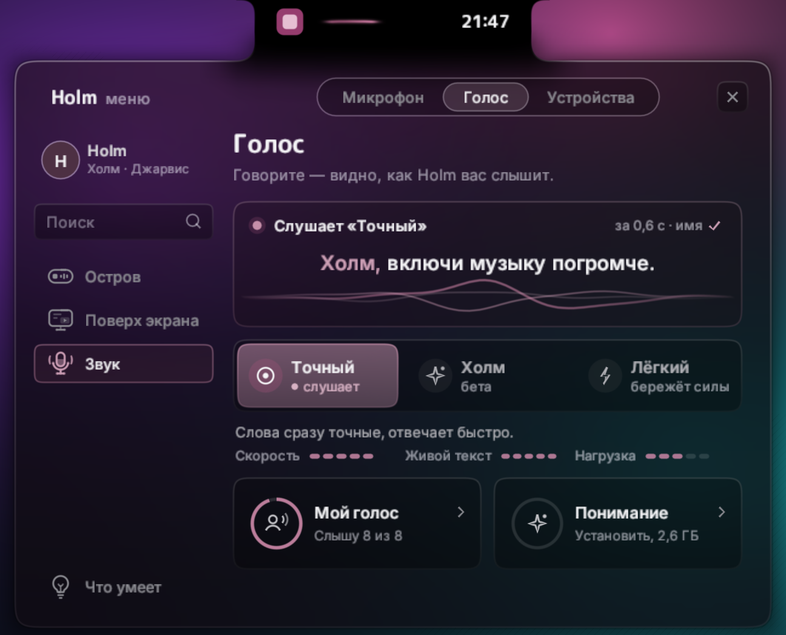</td>
<td>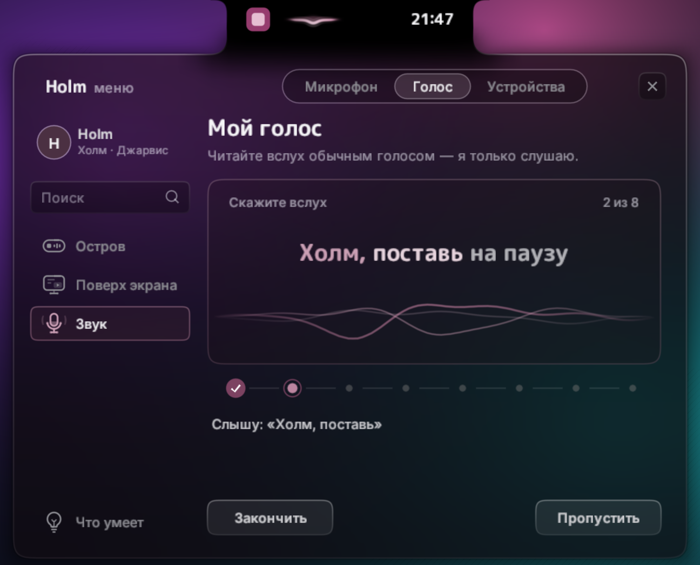</td>
<td>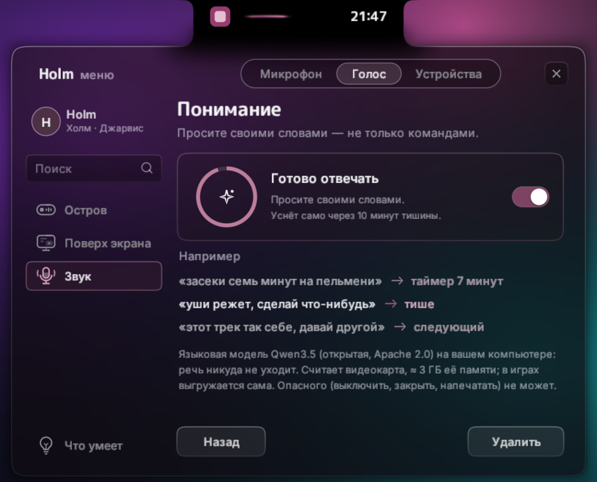</td>
</tr>
</table>

**Имя на выбор.** Откликается на «Холм» — и на прежнее «Джарвис», если вы к нему привыкли: меню → «Holm» → «Отклик».

**Утром поздоровается.** По времени суток, вспомнит, давно ли вы не виделись, заметит праздник и расскажет погоду.

## 🌐 Перевод, которого не видно

Откройте страницу на английском — Holm предложит перевести. Перевод ложится **прямо поверх страницы**, её же шрифтами и цветами: от острова расходится волна, и буквы вихрем дешифруются в русские.

- **Как будто сайт так и написан** — Holm подбирает похожий шрифт (с засечками, узкий, широкий, моноширинный) и стирает оригинал так, что под переводом остаются картинка и градиент.
- **Листайте спокойно** — перевод едет вместе со страницей. В Chrome, Edge, Firefox и Zen.
- **Кнопки живые** — наводите, и перевод перетекает на их новый цвет.
- **Оригинал рядом** — Ctrl показывает всю страницу как есть, Shift над абзацем — только его.
- **Не только страницы** — выделенный текст, «переведи и вставь» вместо выделенного, «что тут написано?» с экрана игры или картинки, «как будет по-английски спасибо». 17 языков.

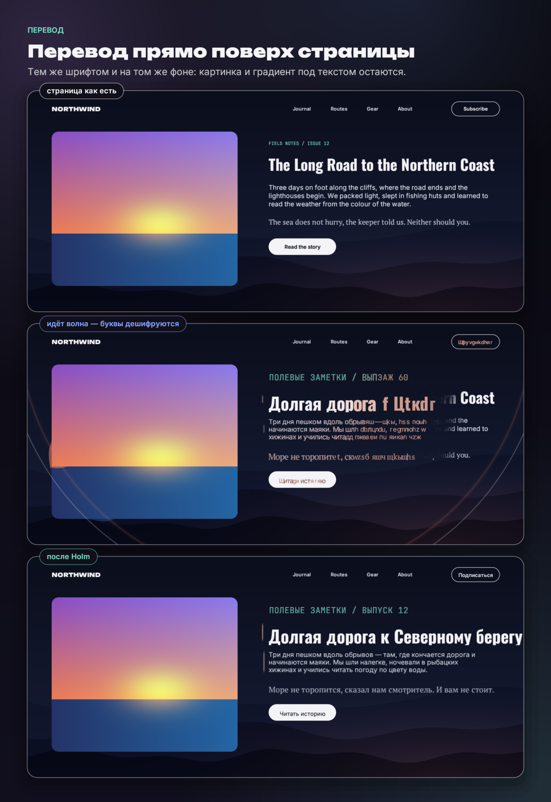

## 🎬 Кино

Откройте ролик на YouTube — Holm предложит кинотеатр. Всё вокруг видео **гаснет от краёв экрана к кадру**, а кадр светится своими цветами, как подсветка у телевизора. Остров перетекает в цвета фильма. Под кадром — **пульт**: пауза, ±10 секунд, перемотка, название ролика и громкость в стеклянной капсуле; он появляется от движения мыши и уходит, когда мышь замерла. Esc или щелчок мимо видео — свет включается обратно.

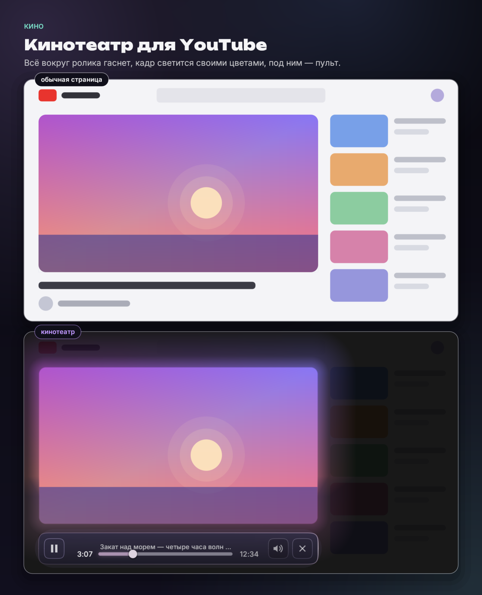

## 🪟 Окна

- **Окно поверх всех** — скажите «картинка в картинке»: ролик из браузера встанет небольшим окном в углу экрана и будет играть, пока вы в другой программе (в Firefox и Zen — даже со свёрнутым браузером). Тот же пульт, что в кинотеатре; окно таскают за картинку, размер меняют колесом, двойной щелчок — обратно на страницу.
- **Свой плеер (бета)** — поставьте его одной кнопкой (меню → «Поверх экрана» → «Окно»), и «окно поверх» играет сам Holm: без кнопок браузера, с плавным размером и списком «Дальше» — что посмотреть следом. Переход с вкладки без паузы: картинка просто перетекает.
- **Окна голосом** — «сверни приложение», «верни», «разверни на весь экран», «закрой вкладку», «сверни всё» — про окно, в котором вы сейчас. И по имени: «сверни дискорд», «верни ютуб».

## 🎧 Звук и игры

- **Микрофон на выбор** — как в Windows или свой. Выключили программу гарнитуры, воткнули другой микрофон — Holm переходит сам, без перезапуска.
- **Микрофон в игры через Holm** — игры подвисают, когда Windows меняет микрофон. Поставьте бесплатный [VB-CABLE](https://vb-audio.com/Cable/), включите в меню → «Звук» → «Отдавать микрофон через Holm» и выберите в игре микрофоном «CABLE Output»: дальше микрофон меняется, а игра этого не замечает.

## 🎵 Музыка, которую видно

- **«Холм, музыку»** — включает именно музыку, даже если плеер ещё не запущен: Holm сам знает, где вы слушаете (Spotify, Яндекс Музыка, Cider, YouTube Music…), запустит и нажмёт «играть».
- **Любой плеер Windows** — Spotify, Яндекс Музыка, YouTube в браузере, Cider.
- **Волна под трек** — бас щиплет струну, малый барабан рябит, нити отдельных инструментов. Три стиля: нити, столбики, точки. Режим «под трек» сам выбирает движение под музыку.
- **Текст песни в такт** — строкой в острове или в карточке.
- **Голосом** — «пауза», «дальше», «перемотай на минуту», «что играет?», «погромче».

## 🛡 Щит от рекламы

Реклама и слежка **не грузятся вообще** — во всех браузерах и программах сразу, без расширений. Windows спрашивает адреса сайтов у Holm, а он не отдаёт рекламные. Один выключатель в меню — и так же одним выключателем всё возвращается как было.

## ✨ Мелочи, которые замечаешь

- **Мгновения Windows** — звук ушёл в наушники, выключился микрофон, пропала и вернулась сеть, сменилась раскладка, вставили флешку, сделан снимок экрана.
- **Точки приватности**, как у iPhone: оранжевая — микрофоном пользуется другая программа, зелёная — камерой.
- **Устройства** — заряд наушников кольцом (и заранее скажет, что садятся), мыши, клавиатуры и геймпады по Bluetooth и на «свистках».
- **Игры** — остров уступает место плашкам игр и запоминает отсчёты из них: «захват через 15 минут» — напомнит вовремя.
- **Вставка текста** туда, где курсор: заготовки из обычного файла, а новые можно продиктовать.
- **Четыре иконки** — лицо, остров, линия, буква — нарисованы кодом.

## ⚙️ Всё настраивается

Волна, лицо, плеер, перевод, кино, микрофон, иконка, имя, на которое он откликается, автозапуск и обновления — в стеклянном меню из пяти комнат, со вкладками и поиском, и каждый вариант показан вживую, прежде чем вы его выберете. Всё, что Holm понимает, — там же: меню → «Что умеет» (или просто: «Холм, что ты умеешь?»).

<table>
<tr>
<td>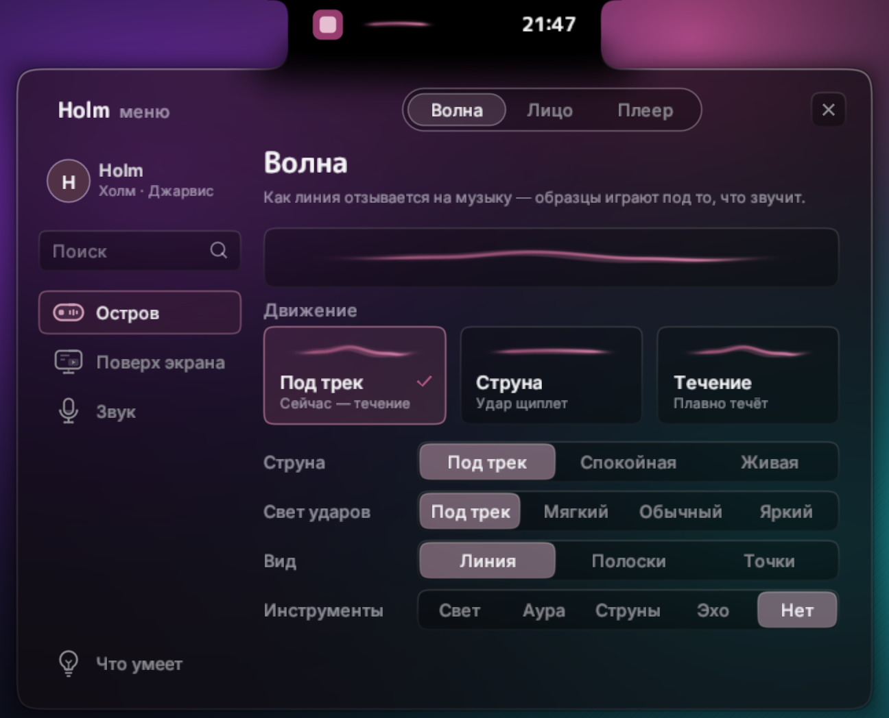</td>
<td>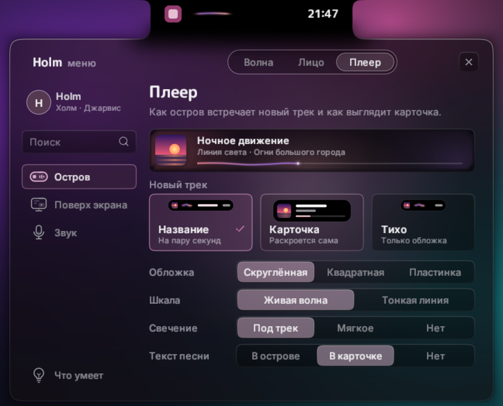</td>
</tr>
<tr>
<td>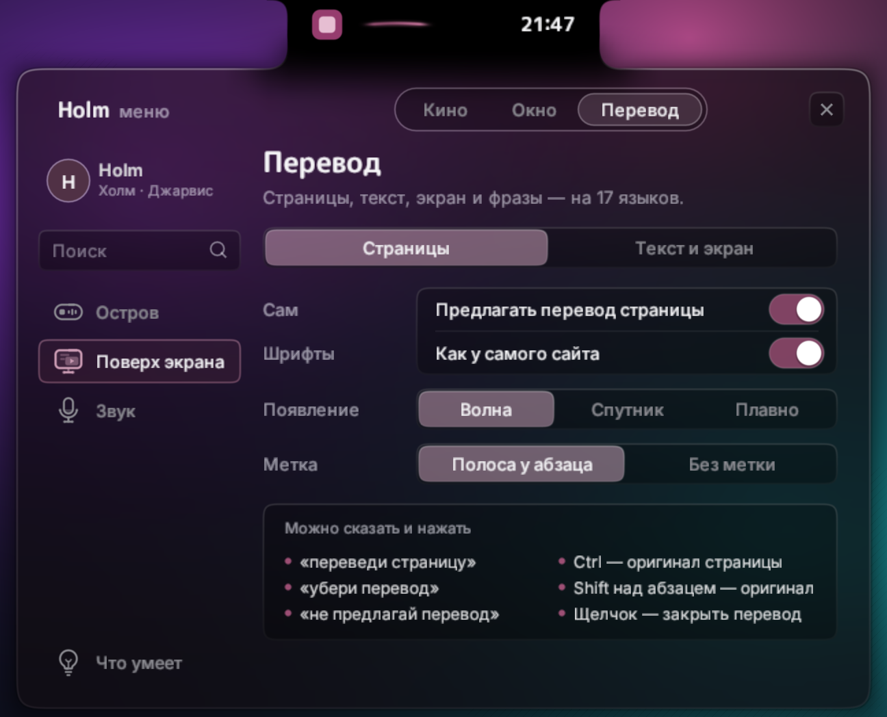</td>
<td>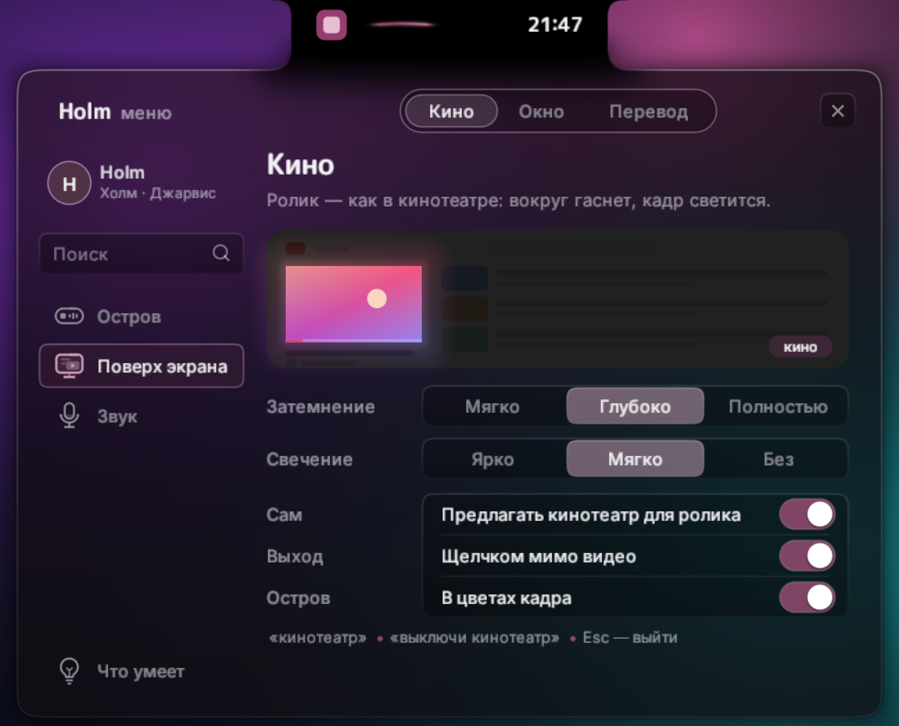</td>
</tr>
<tr>
<td>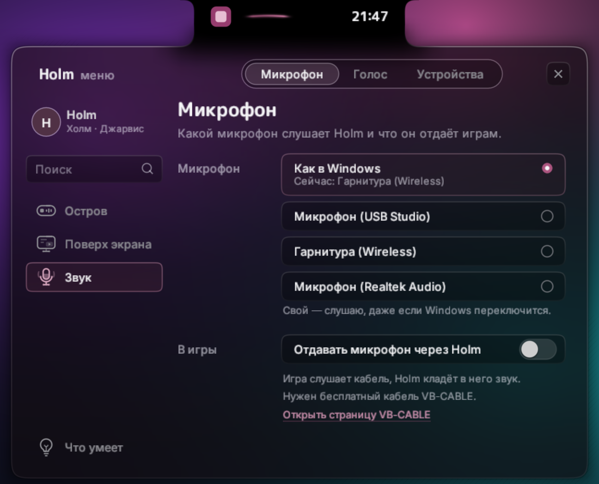</td>
<td>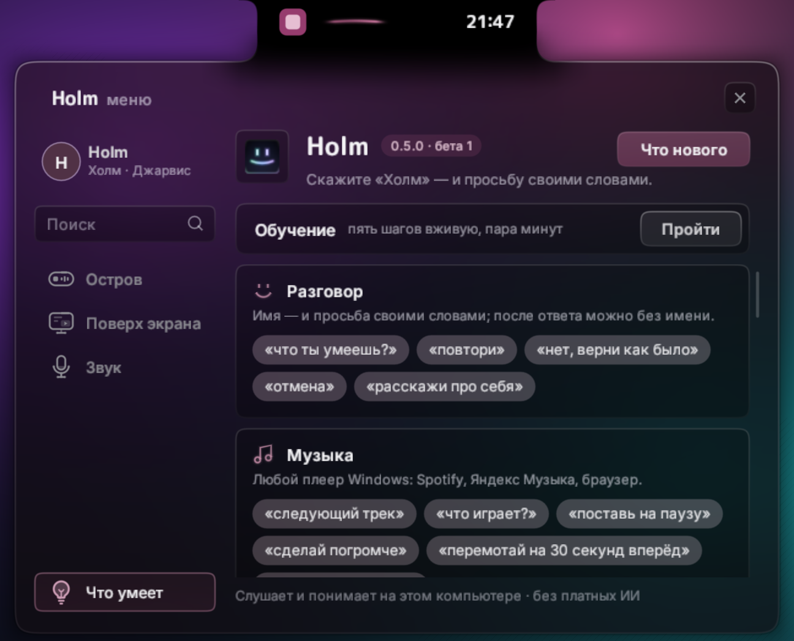</td>
</tr>
</table>

## 💎 Бесплатно и Pro

**Holm бесплатен.** Всё, что описано на этой странице, работает в бесплатной версии — без пробного срока, без аккаунта и без рекламы.

**Holm Pro — готовится.** Это платное дополнение для тех, кому нужно больше. Его ещё нет в продаже; список может измениться.

| Возможность | Бесплатно | Pro |
|---|:---:|:---:|
| Остров: часы, живая волна, лицо, жидкое стекло, четыре иконки | ✓ | ✓ |
| Голос без интернета: просьбы своими словами, «нет» и «верни как было» | ✓ | ✓ |
| Слух на выбор и урок «Мой голос» | ✓ | ✓ |
| **Понимание** — языковая модель на вашем компьютере | ✓ пока бета | ✓ |
| Таймеры, напоминания, погода, счёт, даты, Википедия, память и заготовки | ✓ | ✓ |
| Перевод страниц прямо поверх них — Chrome, Edge, Firefox, Zen | ✓ | ✓ |
| Перевод выделенного, «переведи и вставь», текст с экрана, фраза голосом — 17 языков | ✓ | ✓ |
| Кинотеатр для YouTube: темнота, свечение кадра, пульт под роликом | ✓ | ✓ |
| Музыка: карточка любого плеера, волна под трек, текст песни в такт | ✓ | ✓ |
| Щит от рекламы и слежки во всех браузерах | ✓ | ✓ |
| Мгновения Windows, точки приватности, заряд устройств, плашки игр | ✓ | ✓ |
| Обновление одним касанием | ✓ | ✓ |
| Окно поверх всех: ролик в углу экрана, пока вы в другой программе | ✓ | ✓ |
| **Свой плеер** — ролик играет Holm, без кнопок браузера, со списком «Дальше» | ✓ пока бета | ✓ |
| «Холм, музыку» — музыка с нуля, в вашем сервисе | ✓ | ✓ |
| Окна голосом: свернуть, вернуть, развернуть, закрыть | ✓ | ✓ |
| Микрофон на выбор и микрофон в игры через Holm (с VB-CABLE) | ✓ | ✓ |
| История скопированного, таймер сосредоточенности, диктовка в любое поле | в планах | в планах |
| **Живые субтитры с переводом** — русские субтитры под роликом на чужом языке | — | готовится |

## ⬇ Как поставить

1. Скачайте **`Holm-….zip`** (≈ 22 МБ) из [последнего выпуска](../../releases/latest) и распакуйте папку целиком.
2. Запустите `Holm.exe`. Windows может предупредить о программе без платной подписи: «Подробнее» → «Выполнить в любом случае».
3. Holm познакомится с вами и предложит **скачать голос** — модели распознавания речи, 360 МБ, один раз. После этого он слышит вас без интернета.
4. Скажите: **«Холм, который час?»**

Нет интернета или хочется всё сразу? Возьмите **`Holm-…-full.zip`** (≈ 307 МБ) — в нём голос уже внутри.

**Обновления.** Раз в сутки Holm смотрит, не вышла ли новая версия, и предлагает обновиться карточкой в острове: одно касание — он скачает её, заменит себя и запустится заново. Настройки, память и голос остаются на месте. Проверку можно выключить: меню → «Другое» → «Обновления».

> **Windows 11 пишет «Интеллектуальное управление приложениями заблокировало приложение»?**
> Эта защита не пускает ни одну программу без платной цифровой подписи издателя и не даёт кнопки «всё равно запустить». У Holm такой подписи пока нет — она в работе. До тех пор запустить Holm на таком компьютере можно, только выключив эту защиту: «Безопасность Windows» → «Управление приложениями и браузером» → «Интеллектуальное управление приложениями». Учтите: включить её обратно Windows обычно позволяет только после переустановки системы — решайте сами, стоит ли оно того.

Нужны Windows 10 или 11 и микрофон. Устанавливать и регистрироваться не надо — после первого запуска Holm сам появится в меню «Пуск».

## 🔒 Приватность

- Голос распознаётся **на вашем компьютере** — звук никуда не уходит.
- В сеть уходит только то, о чём вы сами попросили: текст для перевода ([MyMemory](https://mymemory.translated.net)), город для погоды ([Open-Meteo](https://open-meteo.com)), вопрос «что такое…» (Википедия), исполнитель и название трека для текста песни ([LRCLIB](https://lrclib.net)). Щит раз в неделю обновляет списки рекламы ([StevenBlack/hosts](https://github.com/StevenBlack/hosts)).
- Сам Holm ходит в сеть за двумя вещами: один раз скачивает голос (с GitHub, по вашему согласию) и раз в сутки спрашивает у GitHub номер последней версии — эту проверку можно выключить в меню. Плеер (с GitHub) и понимание (с GitHub и Hugging Face) скачиваются, только если вы сами нажали «Установить».
- «Мой голос» и записи просьб (если включите) лежат только на вашем компьютере и стираются одной кнопкой.
- Ни аккаунтов, ни подписок, ни платных нейросетей, ни слежки.

## Лицензия

Holm — бесплатная программа с закрытым исходным кодом: пользуйтесь сколько угодно, но не продавайте и не распространяйте его копии. Подробно — в [LICENSE](LICENSE). Шрифты, модели речи и списки рекламы — по своим свободным лицензиям.
