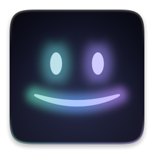

# Holm

### Остров, который слушает.

Голосовой помощник для Windows. Живёт наверху экрана, понимает живую речь, 
переводит страницы прямо поверх них, гасит свет для кино и прячет рекламу. 
**Всё — на вашем компьютере. Бесплатно. Без аккаунтов.**

**[⬇ Скачать для Windows](../../releases/latest)** &nbsp;·&nbsp; [Что нового](CHANGELOG.md) &nbsp;·&nbsp; [Сообщить о проблеме](../../issues)

`Windows 10 / 11` &nbsp; `русский язык` &nbsp; `бесплатно` &nbsp; `без подписок и платных нейросетей`

---

## ✦ Остров

Наверху экрана — чёрная капсула, как Dynamic Island у iPhone. Она живёт:

- **в покое** — часы и волна, которая танцует под настоящий звук;
- **при наведении** — дата, нагрузка процессора и памяти;
- **с музыкой** — карточка трека с обложкой, перемоткой и текстом песни;
- **когда вы говорите** — лицо, которое слушает, думает, улыбается и хмурится.

Свет острова — цветами того, что играет. Меню и карточки — из жидкого стекла: перелив, блики, свет от курсора. Всё движется на пружинах, как в iOS.

## 🎙 Голос — как с человеком

Скажите **«Джарвис»** — и что нужно, своими словами. Holm понимает живую речь: длинные фразы, оговорки, несколько просьб сразу, «нет» и «верни как было». После ответа можно продолжать без имени.

> «Джарвис, поставь таймер на десять минут и сделай погромче»
> «напомни через час позвонить маме»
> «сколько будет 15% от 3200?» · «5 миль в километрах» · «сколько дней до Нового года?»
> «что такое чёрная дыра?» · «какая погода завтра в Казани?»
> «запомни, что машина в сервисе» · «вставь объявление» · «скопируй ссылку»
> «подбрось монетку» · «выбери: пицца или суши»

**Свой мозг, без интернета.** Речь распознаётся на компьютере: быстрый распознаватель пишет черновик на лету, точный — с пунктуацией — дописывает фразу. Тяжёлое распознавание включается, только когда в микрофоне голос.

**Утром поздоровается.** По времени суток, вспомнит, давно ли вы не виделись, заметит праздник и расскажет погоду.

## 🌐 Перевод, которого не видно

Откройте страницу на английском — Holm предложит перевести. Перевод ложится **прямо поверх страницы**, её же шрифтами и цветами: от острова расходится волна, и буквы вихрем дешифруются в русские.

- **Как будто сайт так и написан** — Holm подбирает похожий шрифт (с засечками, узкий, широкий, моноширинный) и стирает оригинал так, что под переводом остаются картинка и градиент.
- **Листайте спокойно** — перевод едет вместе со страницей. В Chrome, Edge, Firefox и Zen.
- **Кнопки живые** — наводите, и перевод перетекает на их новый цвет.
- **Оригинал рядом** — Ctrl показывает всю страницу как есть, Shift над абзацем — только его.
- **Не только страницы** — выделенный текст, «переведи и вставь» вместо выделенного, «что тут написано?» с экрана игры или картинки, «как будет по-английски спасибо». 17 языков.

## 🎬 Кино

Откройте ролик на YouTube — Holm предложит кинотеатр. Всё вокруг видео **гаснет от краёв экрана к кадру**, а кадр светится своими цветами, как подсветка у телевизора. Остров перетекает в цвета фильма. Esc или щелчок мимо видео — свет включается обратно.

## 🎵 Музыка, которую видно

- **Любой плеер Windows** — Spotify, Яндекс Музыка, YouTube в браузере, Cider.
- **Волна под трек** — бас щиплет струну, малый барабан рябит, нити отдельных инструментов. Три стиля: нити, столбики, точки. Режим «под трек» сам выбирает движение под музыку.
- **Текст песни в такт** — строкой в острове или в карточке.
- **Голосом** — «пауза», «дальше», «перемотай на минуту», «что играет?», «погромче».

## 🛡 Щит от рекламы

Реклама и слежка **не грузятся вообще** — во всех браузерах и программах сразу, без расширений. Windows спрашивает адреса сайтов у Holm, а он не отдаёт рекламные. Один выключатель в меню — и так же одним выключателем всё возвращается как было.

## ✨ Мелочи, которые замечаешь

- **Мгновения Windows** — звук ушёл в наушники, выключился микрофон, пропала и вернулась сеть, сменилась раскладка, вставили флешку, сделан снимок экрана.
- **Точки приватности**, как у iPhone: оранжевая — микрофоном пользуется другая программа, зелёная — камерой.
- **Устройства** — заряд наушников кольцом (и заранее скажет, что садятся), мыши, клавиатуры и геймпады по Bluetooth и на «свистках».
- **Игры** — остров уступает место плашкам игр и запоминает отсчёты из них: «захват через 15 минут» — напомнит вовремя.
- **Вставка текста** туда, где курсор: заготовки из обычного файла, а новые можно продиктовать.
- **Четыре иконки** — лицо, остров, линия, буква — нарисованы кодом.

## ⚙️ Всё настраивается

Волна, лицо, плеер, перевод, кино, иконка, автозапуск — в стеклянном меню, и каждый вариант показан вживую, прежде чем вы его выберете. Всё, что Holm понимает, — там же: меню → «О Holm».

## ⬇ Как поставить

1. Скачайте архив из [последнего выпуска](../../releases/latest) и распакуйте папку целиком.
2. Запустите `jarvis.exe`. Windows может предупредить о программе без платной подписи: «Подробнее» → «Выполнить в любом случае».
3. Скажите: **«Джарвис, который час?»**

Нужны Windows 10 или 11 и микрофон. Устанавливать и регистрироваться не надо — после первого запуска Holm сам появится в меню «Пуск» (пока под старым именем Jarvis).

## 🔒 Приватность

- Голос распознаётся **на вашем компьютере** — звук никуда не уходит.
- В сеть уходит только то, о чём вы сами попросили: текст для перевода ([MyMemory](https://mymemory.translated.net)), город для погоды ([Open-Meteo](https://open-meteo.com)), вопрос «что такое…» (Википедия), исполнитель и название трека для текста песни ([LRCLIB](https://lrclib.net)). Щит раз в неделю обновляет списки рекламы ([StevenBlack/hosts](https://github.com/StevenBlack/hosts)).
- Ни аккаунтов, ни подписок, ни платных нейросетей, ни слежки.

## Лицензия

Holm — бесплатная программа с закрытым исходным кодом: пользуйтесь сколько угодно, но не продавайте и не распространяйте его копии. Подробно — в [LICENSE](LICENSE). Шрифты, модели речи и списки рекламы — по своим свободным лицензиям.
